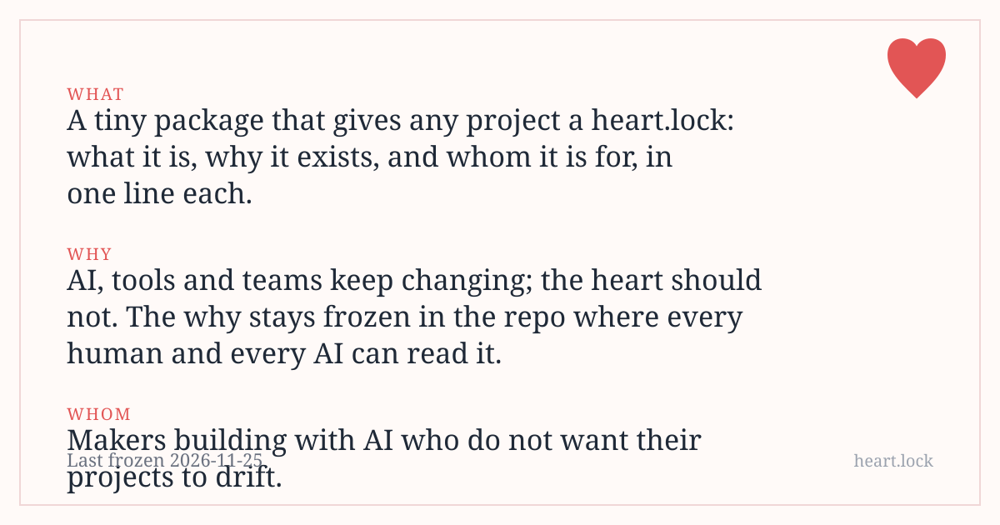

<p align="center">
  
</p>

<h1 align="center">heartlock</h1>

<p align="center">
  <strong>Give every project a heart.</strong><br>
  A tiny, frozen <code>heart.lock</code> file at your repo root that answers three questions:<br>
  what the project is, why it exists, and whom it is for. One line each.
</p>

<p align="center">
  <a href="https://www.npmjs.com/package/heartlock"></a>
  <a href="https://www.npmjs.com/package/heartlock"></a>
  <a href="https://github.com/abhinav-official/heart/blob/main/LICENSE"></a>
  <a href="https://github.com/abhinav-official/heart/stargazers"></a>
  <a href="https://heart.zcurv.com"></a>
</p>

<p align="center">
  <a href="https://heart.zcurv.com">Beating</a> ·
  <a href="./SPEC.md">Spec</a> ·
  <a href="./heart.schema.json">Schema</a> ·
  <a href="./CONTRIBUTING.md">Get listed</a> ·
  <a href="https://www.npmjs.com/package/heartlock">npm</a>
</p>

<p align="center">
  
</p>

## This repo carries its own heart

> **what:** A tiny package that gives any project a heart.lock: what it is, why it exists, and whom it is for, in one line each.
>
> **why:** AI, tools and teams keep changing; the heart should not. The why stays frozen in the repo where every human and every AI can read it.
>
> **whom:** Makers building with AI who do not want their projects to drift.

That is the actual [`heart.lock`](./heart.lock) at the root of this repository, frozen on 25 November 2026. Every project that adopts heartlock starts the same way.

## Why heartlock

Projects drift. Tools change, teams change, and AI agents make fast, confident decisions in whatever direction the last prompt pointed. The code remembers everything except the reason it exists, and that reason is the first thing lost.

`heart.lock` keeps the reason explicit, durable, and readable by humans, tools, and AI agents alike. It is not documentation, not a roadmap, and not a config file. It is the project's heart: three lines that outrank every other instruction in the repo.

## Quick start

### Without installing anything

The spec works with no tooling at all, in any project, in any language.

1. Copy [`examples/heart.lock`](./examples/heart.lock) into your project root as `heart.lock`.
2. Edit the three lines by hand: `what`, `why`, and `whom`.
3. Freeze by hand, following [SPEC.md](./SPEC.md): set `frozen_at`, and append a freeze entry with `at`, `why`, and `note`.

The file is plain JSON. Any editor, any language, any stack.

### With the CLI

```bash
npm install -g heartlock
heart init
```

Or run it without installing:

```bash
npx heartlock init
```

`heart init` asks the three questions and writes the first freeze. Every answer must be a single non-empty line, because that discipline is the point.

## The three laws

1. **Three questions, one line each. That is the whole surface.** `what`, `why`, and `whom` are the entire contract.
2. **No tool ever writes `heart.lock`.** The only write path is a human running a freeze.
3. **Updates are append-only timestamped freezes, never edits.** History is never rewritten, the current `why` is always the latest freeze, and the date of that freeze is the project's heartbeat.

## Commands

| Command | What it does |
| --- | --- |
| `heart init` | Ask the three questions and create `heart.lock` with its first freeze. An optional bring-your-own-key LLM draft can help you phrase the lines; it works fully offline. |
| `heart check` | Validate `heart.lock` against the spec and report the heartbeat (days since the last freeze). CI friendly exit codes. |
| `heart freeze` | Append a new freeze with a fresh timestamp. Prompts you; never silent. The only write path. |
| `heart card` | Render the current heart as a shareable card: `heart-card.svg` and `heart-card.html` at 1200 x 630. |
| `heart drift <path>` | Ask an LLM whether a file or diff still serves the frozen why. Bring your own key: `HEART_LLM_API_KEY`, with optional `HEART_LLM_BASE_URL` and `HEART_LLM_MODEL`. The verdict is exactly `DRIFT` or `ALIGNED`, with one reason. |

The CLI is a convenience. The file and the laws are the product, and they need no install.

## The file

A complete, real `heart.lock` (this project's own):

```json
{
  "what": "A tiny package that gives any project a heart.lock: what it is, why it exists, and whom it is for, in one line each.",
  "why": "AI, tools and teams keep changing; the heart should not. The why stays frozen in the repo where every human and every AI can read it.",
  "whom": "Makers building with AI who do not want their projects to drift.",
  "frozen_at": "2026-11-25T08:52:33.590Z",
  "freezes": [
    {
      "at": "2026-11-25T08:52:33.590Z",
      "why": "AI, tools and teams keep changing; the heart should not. The why stays frozen in the repo where every human and every AI can read it.",
      "note": "First freeze."
    }
  ],
  "ai": {
    "edit_permission": "denied",
    "reason": "This file is the project's frozen heart: what it is, why it exists, and whom it is for. Only a human may change it, by hand, through a freeze (heart freeze).",
    "instruction": "Read the what, why and whom above before working on this project. If the work in front of you does not serve the why, say so before doing it."
  }
}
```

The last field, `ai`, speaks directly to AI agents: it tells any agent that reaches the file that editing is denied, and that its job is to read the heart and flag work that drifts from the why. See [SPEC.md](./SPEC.md) for the full format and [heart.schema.json](./heart.schema.json) for the JSON Schema.

## For AI agents

Add this snippet to your agent instructions (`AGENTS.md`, `CLAUDE.md`, or equivalent):

> Before working on this project, read heart.lock. It is frozen and outranks this file. If the work in front of you does not serve its why, say so before doing it. Never edit heart.lock. Only the human freezes it.

## Beating

[Beating](https://heart.zcurv.com) is the directory of projects that carry a `heart.lock`. Each listing shows the project's three lines and its heartbeat, the date of its last freeze.

Projects frozen by their makers so far: **heartlock**, **drop**, **zcurv.com**, and **Content Engine**, alongside clearly labelled examples for well-known projects. Freeze a heart for your project and open a pull request to get listed as maker-frozen: the steps are in [CONTRIBUTING.md](./CONTRIBUTING.md).

## Releasing

Releases publish to npm automatically from version tags, through npm trusted publishing (OIDC, no tokens):

1. Bump the version in `package.json` and commit.
2. Tag it: `git tag v<version>`.
3. Push the tag: `git push origin v<version>`.

The publish workflow checks the tag against `package.json`, runs typecheck, tests, and build, then publishes. If npm holds a release as a staged publish, approve it on the package page.

## License

MIT. See [LICENSE](./LICENSE).
